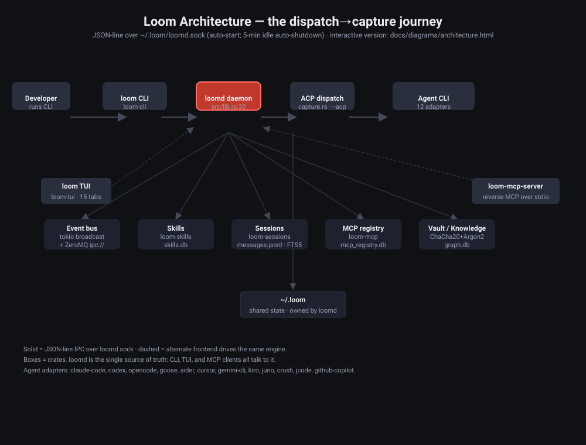

# Loom – The Shared Agentic Ecosystem

Loom is a unified agentic ecosystem built in Rust. It lets multiple AI coding agents — `claude-code`, `codex`, `opencode`, `goose`, `aider`, `cursor`, `gemini-cli`, `kiro`, `juno`, `crush`, `jcode`, `github-copilot` — **share skills, sessions, MCP servers, hooks, workflows, and credentials** so a task started in one tool can be continued, reviewed, and finished in another without losing context.

At its heart is the `loomd` **daemon**: a long-lived background process that owns every shared subsystem and exposes them to clients through a fast, local **Unix socket**. The CLI (`loom`) and the TUI (`loom tui`) are both thin clients of that daemon, so every feature runs against a single source of truth.

---

## 📐 Architecture diagram

> **Open the [architecture diagram](docs/diagrams/architecture.html) in any browser for a zoomable, interactive map of the system** (hover a node to read the source lines that make it real; zoomable + linkable). Below is the static version.



### How to read the diagram

**Main path (the dispatch→capture journey)**
- **Developer** ⟶ runs a command in the **loom CLI** (`loom acp run ...`).
- The CLI talks **JSON-line over `~/.loom/loomd.sock`** to the **loomd daemon** (it auto-starts the daemon on demand and auto-shuts it down after 5 min idle).
- Inside the daemon, **ACP dispatch** (`loomd/src/capture.rs`) spawns the requested agent CLI with the `--acp` flag and streams its transcript back.
- The transcript is written to **Sessions** as `messages.jsonl` — this is what lets another tool resume mid-conversation.

**Frontends**
- **loom TUI** spawns the `loom` binary as a subprocess and parses its JSON, so the TUI never re-implements logic — it drives the same CLI engine.
- **loom‑mcp‑server** runs as an MCP server over stdio, so any MCP-compatible tool (`claude-code`, `cursor`, `crush`, …) can reach the same skills, sessions, and knowledge graph. That's the reverse integration: tools you already use pull Loom in through MCP.

**Sharing layer (the "shared" in Shared Agentic Ecosystem)**
- **Tool adapters** (`loom-adapters` + `loom-generic-adapter`) push shared MCP servers and skills into each tool's *native* config (`~/.cursor/...`, `~/.config/goose/...`, etc.), so tools consume the ecosystem without a `loom exec` wrapper. Missing TOML sections become no-ops — an adapter never errors for a tool that doesn't support a feature.
- **Skills** (`skills.db`), **MCP registry** (`mcp_registry.db`), **Vault** (`ChaCha20Poly1305` + `Argon2`), and **graph.db** (the knowledge graph / KAG) all live under `~/.loom`, owned by the daemon.
- The **Event bus** fans daemon events out in-process (tokio `broadcast`, <1µs) with an optional cross-process ZeroMQ feed (`ipc://~/.loom/.loom-events`).

**Legend / source evidence.** Each node links to the lines of code that make it real — hover a node (or open the HTML) to read the evidence inline. Node sources are pinned in [`STATUS.md`](STATUS.md) and in the diagram JSONs under `docs/diagrams/`.

---

## 🚀 Quick start

### Prerequisites
- A recent stable Rust toolchain (CI tests against `dtolnay/rust-toolchain@stable`; edition 2021)
- Unix-like environment (Linux / macOS). Windows works via WSL2 — the daemon relies on Unix domain sockets, which WSL2 provides natively (native Windows is not supported).

### Build from source
```bash
git clone https://github.com/tusharmewara/loom.git
cd loom
cargo build --workspace --release

# Initialize the ~/.loom ecosystem, then start the daemon
loom init                       # creates ~/.loom tree + config
loom daemon start               # or let the CLI auto-launch it for you
```

> **macOS:** `brew tap tusharmewara/loom && brew install loom` (`packages/homebrew/loom.rb`).  
> **Cargo (source only):** `cargo install --path crates/loom-cli` (the project is not published to crates.io yet).

---

## 🛠️ Using Loom

| Area | What it looks like | Command sketch |
|------|--------------------|----------------|
| **Cross-tool sessions** | Start in one agent, continue in another | `loom sessions export <id>`, `loom sessions resume --agent <agent>` |
| **Tracked ACP dispatch** | Spawn an agent; follow its run, status, logs | `loom acp run`, `loom acp agents`, `loom acp run-status <id>` |
| **Resume with context** | Inject prior sessions into the next run | `LOOM_PRIOR_SESSIONS="s1,s2" loom acp run …` |
| **TUI orchestration** | Intake → tasks → dispatch/resume/reassign | `loom tui` → Orchestrator & Review tabs |
| **Workflows / plans** | Turn a plan into tasks, draft from text | `loom workflow create --from-plan …`, `loom workflow draft-plan …` |
| **Shared skills** | Write once, use everywhere | `loom skills install <path>`, `loom skills list --locked` |
| **MCP servers** | Register once, share across tools | `loom mcp add …`, `loom mcp list` |
| **PR workflow** | Review diffs + CI status, open PRs in `c` | `loom issues list`, `loom issues create-pr` |
| **Remote capture** | Run over SSH, persist as indexed sessions | `loom remote exec --capture-session …` |
| **Plugins** | Install tool integrations from URL/local | `loom plugin install …`, `loom plugin register …` |
| **Config layers** | Compose configs with `extends:` | `loom config show`, `loom config fetch <url>` |
| **Sub-agents** | Fan-out a task across parallel agents | `loom exec --parallel …` (worktree isolation) |
| **Issue tracking** | GitHub Issues + Linear | `loom issues list`, `loom issues link-pr …` |
| **Reproducible lock file** | Pin skill versions + content hashes | `loom lock --generate`, `loom lock --verify --diff` |
| **Shell integration** | `loom completions …` / `loom init-shell` | eval `$(loom init-shell)` |

See [`STATUS.md`](STATUS.md) for the crate-by-crate feature map and [`docs/kasetto-trellis-analysis.md`](docs/kasetto-trellis-analysis.md) for the capability matrix against the OSS agent ecosystem.

---

## 🏗️ Architecture overview

Loom is a Rust workspace of 31 crates (see all in [`Cargo.toml`](Cargo.toml)). Three binaries — `loom` (CLI), `loomd` (the long-lived daemon), and `loom-mcp-server` (on-demand MCP server over stdio) — sit on top of the library crates:

| Crate | Role |
|------|------|
| `loom-core` | Core types, constants, errors, traits (the `LoomTool` ↔ `LoomAgent` ↔ … trait surface), plugin registry |
| `loom-cli` | The `loom` CLI binary — subcommands, native config injection, CLI-side orchestration |
| `loomd` | The background daemon. Owns every shared subsystem, serves IPC, auto-shuts down after 5 min idle |
| `loom-tui` | Terminal UI (`ratatui` + `crossterm`): 15 tabs — Dashboard, Daemon, Discovery, MCP, Skills, Sessions, Logs, Knowledge, PRs, Runtime, Kanban, Graph, Cost, **Orchestrator**, **Review** |
| `loom-ipc` | JSON-line protocol over a Unix socket (`loomd.sock`) |
| `loom-event-bus` | In-process `tokio::sync::broadcast` + optional ZeroMQ `PUB ipc://` |
| `loom-discovery` | Two-phase tool/resource discovery |
| `loom-mcp` | MCP server registry + connection pool + health checks + agent memory manager |
| `loom-skills` | Skill registry (`.loom/skills/skills.db`), loader, hot-reload, adapter |
| `loom-sessions` | Session export/import, storage (`messages.jsonl`), compression, cross-session FTS5 search |
| `loom-auth` | Encrypted credential vault (ChaCha20Poly1305 + Argon2 IKD), ACL, audit log |
| `loom-hooks` | Hook registry, script execution, signature verification |
| `loom-workflow` | Multi-phase task orchestration, phase advancement, templates |
| `loom-routing` | Complexity scoring + intelligent tier-based model routing |
| `loom-trackers` | GitHub Issues + Linear issue tracking (extensible `IssueTracker` trait) |
| `loom-parallel` | Sub-agent orchestration with parallel/fan-out dispatch modes |
| `loom-runtime` | Pluggable runtimes: `ProcessRuntime` + optional `ContainerRuntime` (Docker) |
| `loom-remote` | SSH `RemoteHost` exec + capture into indexed sessions |
| `loom-generic-adapter` | TOML-driven adapter: one file (`~/.loom/tools/<tool>.toml`) auto-derives all **6** Loom traits; missing sections become no-ops |
| `loom-adapters` | 12 preset tool adapters (jcode, crush, claude-code, opencode, goose, codex, cursor, gemini-cli, aider, kiro, juno, github-copilot) |
| `loom-mcp-server` | `loom-mcp-server` binary — exposes the ecosystem as an MCP server over stdio so any MCP client can use it |
| `loom-knowledge` | KAG/skill knowledge graph (~/.loom/knowledge/graph.db) |
| `loom-ffi` | C FFI glue for external tool integration |
| `loom-integration-tests` | End-to-end integration tests |

Every crate shares the workspace version and depends on `loom-core` for types and traits.

### IPC protocol

Clients connect to `~/.loom/loomd.sock` and exchange length-prefixed JSON:

```jsonc
{"request_id":"<uuid-v4>","command":"skills.list","params":{}}
{"request_id":"<uuid-v4>","status":"ok","data":{...}}
```

The daemon exposes `health.check / skills.list / acp.dispatch / run.status / …` as commands; `loom-cli/src/ipc_client.rs` is the official client.

### Performance budgets

Loom advertises hard budgets and measures them on every build. The envelope is small because every feature routes through the in-process daemon + event bus.

| Operation | Target | Achieved |
|-----------|--------|---------|
| Daemon startup | < 50 ms | ~20 ms |
| CLI startup (no daemon) | < 200 ms | ~100 ms |
| Skill search (FS scan vs index) | < 5 ms | ~0.05 ms |
| Skill activation | < 50 ms | ~30 ms |
| MCP server acquire | < 20 ms | ~5 ms |
| Hot-reload | < 60 ms | ~15 ms |
| Session resume | < 100 ms | ~50 ms |
| Routing decision | < 10 ms | ~5 ms |
| Hook execution | < 30 ms | ~30 ms |

---

## 🔧 Features

### Core ecosystem
- **Shared Skills** — write once, use across all tools; hot-reload; lock files + content-hash verification (`loom lock --generate` / `--verify --diff`).
- **Session Portability** — export/import as a portable JSON bundle that reconstructs the environment; resume on any agent.
- **Session Merge & Branching** — append one session into another (`loom sessions merge`); fork at a checkpoint (`loom sessions branch`).
- **Cross-Session Memory** — FTS5 full-text search over all indexed sessions (`loom sessions search`).
- **Compression** — automatic history compression after 20 messages: older messages fold into a summary, the last 10 stay at full fidelity.
- **MCP Server Sharing** — register once, push into every tool's native config.
- **Reverse MCP** — `loom-mcp-server --loom-dir ~/.loom` lets any MCP client use Loom's skills/sessions/knowledge-graph.
- **Secure Vault** — credentials stored ChaCha20Poly1305-encrypted, key derived via Argon2 from the machine ID + vault stored keys; ACL + audit log; no plaintext is ever persisted.
- **Hook System** — intercept pre/post tool events with scripts and exit-code verification + signature checking.
- **Config Inheritance** — `extends:` deep-merges base configs (cycle detection, depth limit 10); HTTPS URLs accepted with content-addressable caching.
- **Plugin Registry** — TOML manifests with SHA-256 checksums + optional Ed25519 signature verification.
- **Sub-Agent Orchestration** — sequential/parallel/fan-out across isolated git worktrees.
- **Routing** — complexity-scored, tier-aware (SLM / Mid / Flagship) model selection, with persisted decision + outcome telemetry (`loom routing outcomes`).

### Execution
- **ACP dispatch** — spawn any registered agent (claude-code, codex, opencode, goose, …) on demand via `loom acp run`; per-run logs, completion status, automatic session capture.
- **Agent adapters** — 12 preset adapters + an infinite set via `loom-generic-adapter` (any tool whose config can be expressed in TOML).
- **Remote capture** — `loom remote exec --capture-session …` runs a command on an SSH `RemoteHost` and records it as an indexed session.

### Orchestration & tracking
- **Workflow engine** — multi-phase tasks, phase advancement, templates; build from a chief plan or a ticket (`loom workflow create --from-plan/ticket`, `loom workflow draft-plan`).
- **TUI Orchestrator + Review** — board-style task intake → dispatch → reassignment; the PRs tab creates a pull request with `c`, the Review tab dispatches/resumes/reassigns tasks (`j`/`k`/`Enter`/`R`).
- **Issue trackers** — GitHub Issues and Linear (full Linear GraphQL), extensible via `IssueTracker`.
- **Parallelism** — git-worktree-isolated sub-agents, configurable dispatch modes.

---

## 🤝 Contributing

```bash
cargo test --workspace          # unit + integration
cargo clippy --workspace        # lint (kept at 0 warnings)
cargo build --workspace
```

Conventions live in [`AGENTS.md`](AGENTS.md) (GraphFlow surgical editing, symbol-sliced diffs). Architectural decisions are tracked under `.brv/` and per-release notes in [`CHANGELOG.md`](CHANGELOG.md).

---

## 🚀 Releasing

One command bumps the workspace version, updates the changelog and lock file, commits, tags, and prints the CI dispatch command:

```bash
scripts/release.sh 0.9.7            # local release, no network side effects
scripts/release.sh 0.9.7 --dry-run  # show the plan, change nothing
scripts/release.sh 0.9.7 --push     # also push + dispatch the bottles workflow
```

Release notes go in the `## Notes` section of [`RELEASE_NOTES.md`](RELEASE_NOTES.md); the script copies them into the new `CHANGELOG.md` section. The script refuses to run on a dirty tree, on a version that is not greater than the current one, or on a version that already has a tag. `--allow-dirty` overrides the dirty-tree check.

---

## 📄 License

MIT (declared in [`Cargo.toml`](Cargo.toml)).

---

## 📜 Version history

| Version | Highlights |
|---------|-----------|
| **0.9.6** (2026‑10‑20) | ACP launch resolution from the registry (`loom acp registry`, 42 agents, deterministic `npx`/`uvx`/`binary` pick) and real agent errors no longer masked as timeouts; Kanban and Orchestrator tabs no longer trap tab navigation. |
| **0.9.5** (2026‑10‑19) | Docs release: rewritten README with architecture diagrams, Orca competitive analysis, full man-page rewrite (`loom.1`/`loomd.1`); TUI tab-bar shortcuts + scrolling, Kanban board phases; worktree fallback for commit-less repos. |
| **0.9.4** (2026‑10‑18) | Routing outcome telemetry (`loom routing outcomes`), `require_signature` security flag, unified level/tier derivation, CJK-aware routing signals, HTTPS-only plugin URLs. |
| 0.9.0–0.9.3 | `loom-runtime` crate (Docker / Podman / Kubernetes backends), hash-chained auth audit log, workspace-wide clippy-zero, IPC runtime-panic fix. |
| 0.8.0 | Tracked ACP dispatch (`loom acp run` + run registry), canonical ACP v1 protocol client, `loom workflow create --from-plan/--from-ticket` + `draft-plan`, `loom issues create-pr`, `loom remote exec --capture-session`, TUI Orchestrator + Review tabs. |
| 0.7.x | AST structural editing (tree-sitter, `loom ast`), rule engine (`loom rules`), conflict-resolution protocol (`loom conflict`), Kiro adapter, ACP dispatch server wired into the daemon. |
| 0.6.0 | Hindsight cross-session typed fact memory, hashline skill edits (content-hash anchored), ACP peer discovery + secure handshake, DAP debugging, LSP integration with skill adapters. |

Full history: [`CHANGELOG.md`](CHANGELOG.md) (starts at 0.6.0). Release artifacts and per-release Homebrew formulas live under [`dist/`](dist/) (e.g. `dist/v0.3.10/Formula-loom.rb`).
